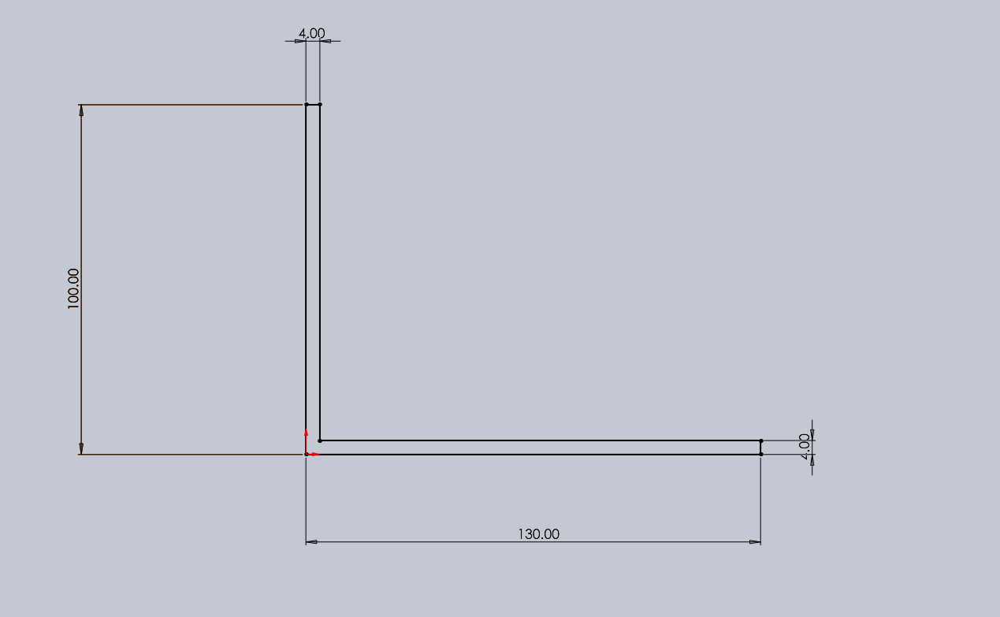

# Lightweight Motor Bracket - Structural Optimisation

**SolidWorks + ANSYS Workbench | Aluminium 6061-T6 | Parametric CAD, static FEA and mesh verification**

This project investigates how the geometry and thickness of a lightweight L-shaped electric-motor mounting bracket influence its mass, deformation and stress under an assumed static motor load. Four internal-corner geometries were explored (R0, R2, R5 and R10), followed by a parameterised thickness sweep of the R10 design.

> **Scope:** Numerical design study. Results are conditional on the stated static load, simplified bolted supports, material model and a project-defined 0.5 mm deflection threshold. They are not physical test certification.


## Key results

| Measure                                       |            Result |
| --------------------------------------------- | ----------------: |
| Material                                      | Aluminium 6061-T6 |
| Project-defined maximum deflection            |          0.500 mm |
| Baseline R10 thickness                        |            4.0 mm |
| Baseline R10 mass (ANSYS)                     |          297.15 g |
| Lightest passing **tested** thickness         |        **3.6 mm** |
| Optimised mass                                |      **268.60 g** |
| Mass reduction relative to 4 mm R10           |         **9.61%** |
| Maximum deflection, refined 3.6 mm mesh       |    **0.46449 mm** |
| Maximum von Mises stress, refined 3.6 mm mesh |    **29.873 MPa** |
| Indicative material-yield ratio, 275/29.873   |           **9.2** |

**Result:** The 3.6 mm R10 variant is the minimum-mass design _among the thicknesses tested_ that meets the assumed deflection requirement. The 3.75 mm variant offers more deflection margin, but has not received the same mesh-refinement check. A standard 4 mm sheet may be simpler to source and manufacture.

## Design and geometry

- L-shaped single-piece bracket, nominal envelope **130 mm long x 120 mm wide x 100 mm high**.
- Wall mounting: **4 x Ø6.6 mm** clearance holes.
- Motor mounting: **4 x Ø5.5 mm** holes.
- Corner radii compared: **R0, R2, R5, R10 mm**.
- Parametric R10 CAD model: `BracketThickness` drives the two plate thickness dimensions; holes and R10 fillet are regenerated for each design point.
- Material model for the structural study: **density 2700 kg/m³**, **Young's modulus 69 GPa**, **Poisson's ratio 0.33**, **tensile yield strength 275 MPa**.

| Baseline profile                                   | R10 design                                 |
| -------------------------------------------------- | ------------------------------------------ |
|  |  |

### Initial CAD variants

| R2                                      | R5                                      | R10                                       |
| --------------------------------------- | --------------------------------------- | ----------------------------------------- |
|  |  |  |

## FEA setup

| Item               | Simulation assumption                                                |
| ------------------ | -------------------------------------------------------------------- |
| Solver             | ANSYS Mechanical, static structural                                  |
| Material           | Isotropic Aluminium 6061-T6                                          |
| Support            | Four vertical-plate mounting-hole cylindrical faces treated as fixed |
| Applied force      | **40 N** downward, global **Y = -40 N**                              |
| Load transfer      | Deformable remote force attached to four motor mounting-hole faces   |
| Remote-force point | **(X, Y, Z) = (80, 2, 60) mm**, held at fixed global coordinates     |
| Primary output     | Maximum total deformation                                            |
| Secondary outputs  | Maximum von Mises stress and solid mass                              |
| Design threshold   | Maximum total deformation **≤ 0.5 mm**                               |

The remote force represents a simplified static loading condition. The model does not explicitly include bolts, contact, preload, washers, motor torque, vibration, or support flexibility.

## Parametric thickness sweep

The R10 CAD model was evaluated at **15 design points**, including a repeated 4 mm reference point; the table below presents **14 distinct thicknesses**.

| Thickness (mm) | Mass (g) | Max deformation (mm) | Max von Mises (MPa) | Deflection ≤ 0.5 mm |
| -------------: | -------: | -------------------: | ------------------: | :-----------------: |
|              2 |   153.35 |              2.67140 |              90.907 |        Fail         |
|            2.5 |   189.54 |              1.37520 |              59.670 |        Fail         |
|              3 |   225.58 |              0.79779 |              42.066 |        Fail         |
|           3.25 |   243.53 |              0.62771 |              35.396 |        Fail         |
|            3.4 |   254.28 |              0.54829 |              33.012 |        Fail         |
|            3.5 |   261.45 |              0.50250 |              31.216 |        Fail         |
|            3.6 |   268.60 |              0.46143 |              29.106 |        Pass         |
|           3.75 |   279.32 |              0.40858 |              26.132 |        Pass         |
|            3.9 |   290.02 |              0.36293 |              24.138 |        Pass         |
|              4 |   297.15 |              0.33623 |              23.337 |        Pass         |
|            4.5 |   332.70 |              0.23561 |              18.481 |        Pass         |
|              5 |   368.08 |              0.17107 |              15.144 |        Pass         |
|            5.5 |   403.31 |              0.12788 |              12.962 |        Pass         |
|              6 |   438.37 |              0.09796 |              17.898 |        Pass         |

The 3.5 mm candidate narrowly misses the deflection criterion (**0.50250 mm**), while 3.6 mm passes in the sweep (**0.46143 mm**). These sweep values use the original mesh settings; a finer mesh is assessed below.

### Design trade-off charts


Raw data: [`Thickness_Sweep_Results.csv`](Results/Thickness_Sweep_Results.csv).

**Data flag:** The 6 mm sweep point has a higher reported maximum von Mises stress than the 5.5 mm point, despite the greater thickness. This non-monotonic result should be investigated for mesh sensitivity, constraint effects, geometric changes and load-path effects; it is not treated as a validated physical trend.

## Mesh verification of the 3.6 mm candidate

The initial 3.6 mm sweep result was checked using a finer global mesh and then additional local refinement on the curved R10 inner fillet. The Student licence prevented a full global 2 mm solve at the available model size.

| Mesh configuration                       |        Nodes |     Elements | Maximum deformation (mm) | Maximum von Mises stress (MPa) |
| ---------------------------------------- | -----------: | -----------: | -----------------------: | -----------------------------: |
| Global 4 mm                              | Not recorded | Not recorded |                  0.46143 |                         29.106 |
| Global 3 mm                              |       62,435 |       36,306 |                  0.46391 |                         30.226 |
| Global 3 mm + local 2 mm R10 face sizing |       69,652 |       41,018 |              **0.46449** |                     **29.873** |

Between the last two meshes, **maximum displacement changed by about 0.13%** and the reported **maximum stress changed by about -1.17%**. This supports displacement convergence for the model and tested mesh changes. The maximum stress value should still be treated cautiously because it is concentrated near the idealised mount constraints and was not independently verified using a fully converged local stress study.

Mesh data: [`Mesh_Verification_3p6mm.csv`](Results/Mesh_Verification_3p6mm.csv).

## Design decision

**3.6 mm - numerical minimum-mass candidate.** It has a mass of **268.60 g** and a refined maximum deflection of **0.46449 mm**, leaving a **0.03551 mm (7.1%)** margin below the stated threshold.

**3.75 mm - more conservative simulated alternative.** The sweep predicts **279.32 g** mass and **0.40858 mm** deflection. This candidate is not yet confirmed by the same refined-mesh check used on 3.6 mm.

**4 mm - practical stock option.** It is heavier at **297.15 g**, but may be preferable if standard stock availability, manufacturing repeatability or a larger modelling uncertainty allowance outweigh approximately 28.55 g of additional mass.

Using the refined 3.6 mm peak equivalent stress and the nominal 275 MPa tensile yield strength gives a _nominal material-yield stress ratio_ of approximately **9.2**. This is **not** a validated assembly-level factor of safety. Bolted-joint behaviour, motor torque, fatigue and physical tests remain unverified.

## Limitations and next steps

1. Replace fully fixed hole faces with more representative bolted constraints or contact modelling.
2. Include motor torque, vibration and other realistic loading cases if required by the intended application.
3. Examine local peak stresses at the constrained holes and investigate the 6 mm stress anomaly.
4. Check standard stock thicknesses and feasible methods for producing the R10 bend geometry.
5. Manufacture and test a prototype before making claims about in-service performance.

## Repository contents

```text
lightweight-motor-bracket-fea/
├── CAD/              # CAD source and exchange geometry
├── FEA/              # Selected ANSYS model/project artifacts
├── Animations/       # Deformation and equivalent-stress animations
├── docs/             # Chronological CAD and FEA screenshots
├── Results/
│   ├── Graphs/       # Four result figures
│   ├── Thickness_Sweep_Results.csv
│   └── Mesh_Verification_3p6mm.csv
├── .gitignore
└── README.md
```

Some ANSYS project files may have version-specific dependencies and substantial generated-data directories. Screenshots, CSVs and plots are provided as easier-to-review supporting evidence. An independent result reproduction requires matching material properties, geometry, supports, remote-force definition and meshing controls.

## Tools

- SolidWorks - baseline geometry and fillet variants
- ANSYS DesignModeler - parameterised thickness geometry
- ANSYS Mechanical / Workbench - static FEA, output parameters and design-point sweep
- CSV-based plotting - result visualisation and trade-off analysis

---

## Author

**Farhan Ali**  
Mechanical Engineering Student | CAD, FEA & Structural Optimisation

- **GitHub:** [farhan10904](https://github.com/farhan10904)
- **Portfolio:** [Farhan Ali Engineering Portfolio](https://farhan10904.github.io/engineering-portfolio/)
- **LinkedIn:** [Farhan Ali](https://www.linkedin.com/in/farhan-ali-95047a245/)

Built as an independent engineering project exploring mechanical design, finite element analysis, mesh verification, parametric optimisation and lightweight structural design.

---

## Acknowledgements

**Software:** SolidWorks and ANSYS Mechanical were used for CAD development, structural simulation and parametric analysis.

**AI assistance:** AI tools were used for project planning, technical explanations, troubleshooting and documentation assistance. CAD development, simulation setup, engineering decisions, result interpretation and verification were carried out and reviewed by the author.

---
