# Lightweight Motor Bracket | Structural Optimisation

**SolidWorks · ANSYS Mechanical · Parametric CAD · Finite Element Analysis**

A numerical design study of an aluminium electric-motor mounting bracket. I compared four bend geometries, automated a 15-point thickness sweep, and verified the lowest-mass candidate with a refined finite-element mesh.

<p align="center">
  <a href="Results/FEA/01_R10_3p6mm_Deformation.png">
    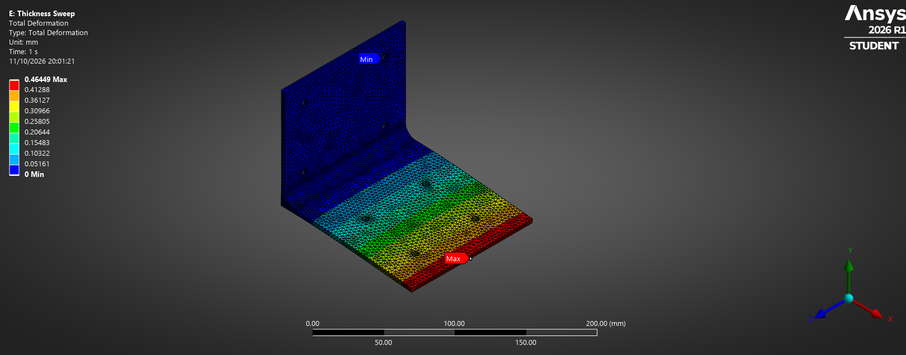
  </a>
</p>
<p align="center"><em>Optimised R10 bracket - total deformation under the assumed 40 N static load (refined mesh).</em></p>

### At a glance

| Design outcome                                              |         Result |
| :---------------------------------------------------------- | -------------: |
| Lightest **tested** thickness meeting the deflection target |     **3.6 mm** |
| Mass                                                        |   **268.60 g** |
| Mass reduction vs 4 mm R10 design                           |      **9.61%** |
| Refined maximum deformation                                 | **0.46449 mm** |
| Project deflection target                                   | **≤ 0.500 mm** |
| Refined peak von Mises stress                               | **29.873 MPa** |
| Estimated material yield-stress ratio                       |        **9.2** |

> **Scope:** These are simulation results for a simplified static loading case. They do not establish physical, bolted-assembly or fatigue performance. The 0.5 mm limit is a project-defined design criterion.

**Jump to:** [CAD evolution](#1-cad-evolution) · [FEA setup](#2-fea-setup) · [Animations](#3-result-animations) · [Thickness sweep](#4-parametric-thickness-sweep) · [Mesh verification](#5-mesh-verification) · [Design decision](#6-design-decision)

---

## 1. CAD evolution

The bracket began as a simple right-angle profile. I added the motor and wall mounting holes, then investigated whether increasing the inner bend radius would reduce local stress and improve stiffness without significantly increasing mass.

|                                           Original bracket                                            |                                    R10 filleted bracket                                    |
| :---------------------------------------------------------------------------------------------------: | :----------------------------------------------------------------------------------------: |
| 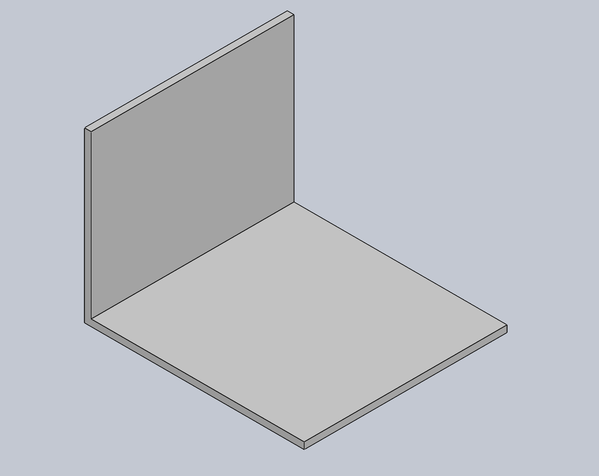 | 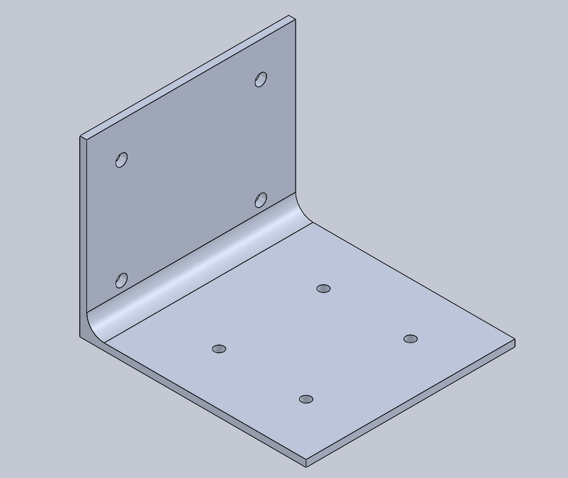 |

**Geometries compared:** R0 (sharp corner), R2, R5 and R10 mm internal fillets.

|                                  R2                                   |                                  R5                                   |                                   R10                                   |
| :-------------------------------------------------------------------: | :-------------------------------------------------------------------: | :---------------------------------------------------------------------: |
| 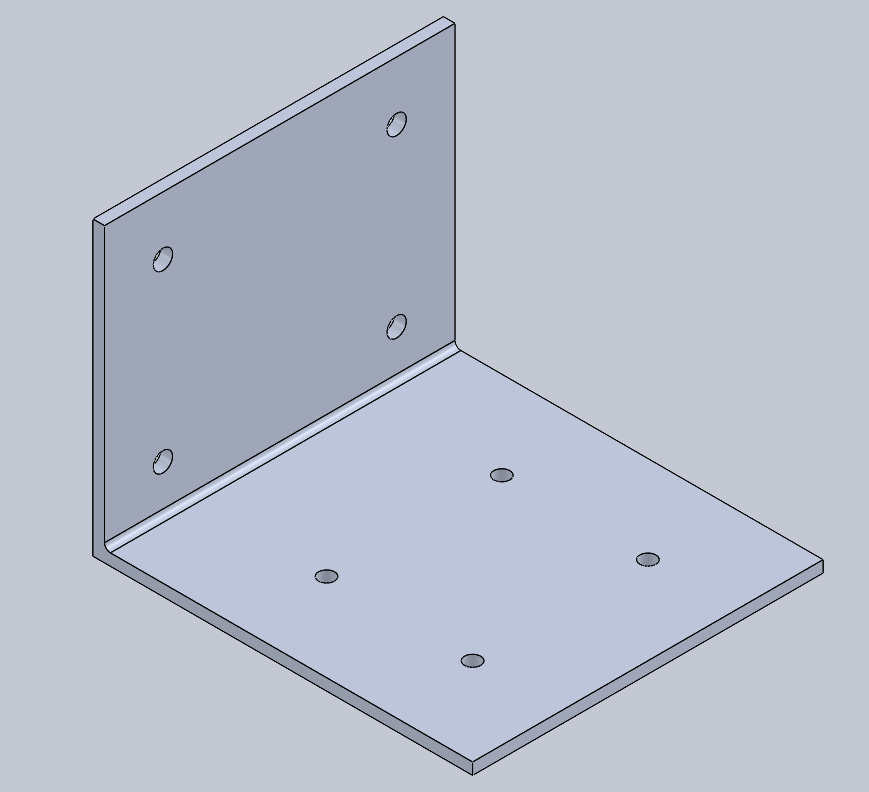 | 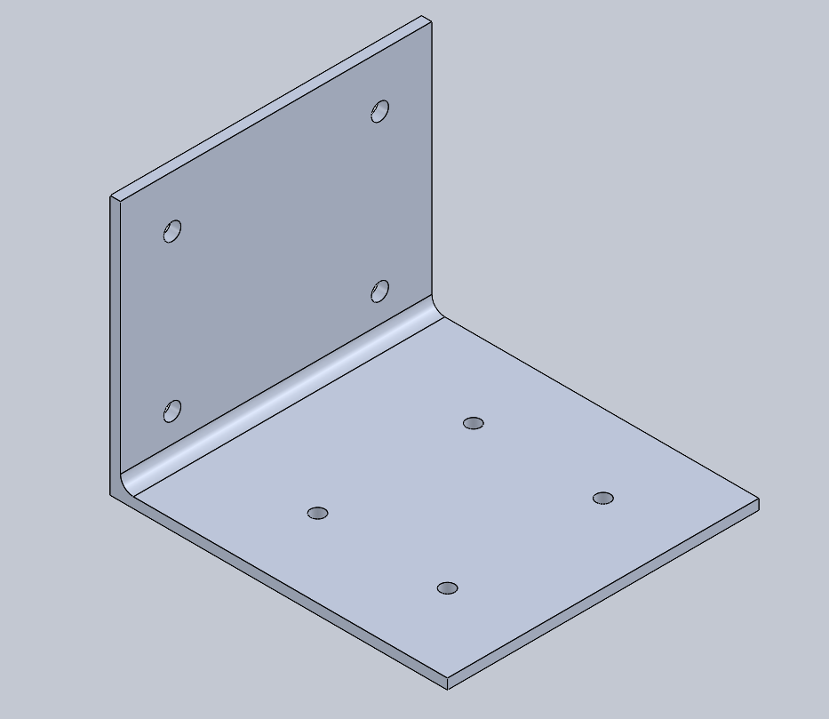 |  |

**Reference geometry**

- Nominal envelope: **130 mm length x 120 mm width x 100 mm height**.
- Four wall-mount holes: **Ø6.6 mm**.
- Four motor-mount holes: **Ø5.5 mm**.
- Material: **Aluminium 6061-T6**.
- The R10 variant was rebuilt in ANSYS DesignModeler with a shared `BracketThickness` parameter controlling both legs of the bracket.

The geometry study preceded the thickness study: **the final thickness sweep keeps the R10 bend radius and varies the bracket thickness**.

---

## 2. FEA setup

**Solver:** ANSYS Workbench / Mechanical, Static Structural.

| Setup item                     | Definition                                                   |
| :----------------------------- | :----------------------------------------------------------- |
| Material                       | Isotropic Aluminium 6061-T6                                  |
| Young's modulus                | 69 GPa                                                       |
| Poisson's ratio                | 0.33                                                         |
| Density                        | 2700 kg/m³                                                   |
| Nominal tensile yield strength | 275 MPa                                                      |
| Mounting restraint             | Four wall-hole cylindrical faces, **Fixed Support**          |
| Applied loading                | **40 N downward** in global Y (`Fy = -40 N`)                 |
| Load transfer                  | **Deformable Remote Force**, scoped to four motor-hole faces |
| Remote-force location          | **(80, 2, 60) mm**, global coordinates                       |
| Design criterion               | Maximum deformation **≤ 0.5 mm**                             |

|                                         Fixed support at wall holes                                          |                                  Load applied through motor mounting holes                                  |
| :----------------------------------------------------------------------------------------------------------: | :---------------------------------------------------------------------------------------------------------: |
| 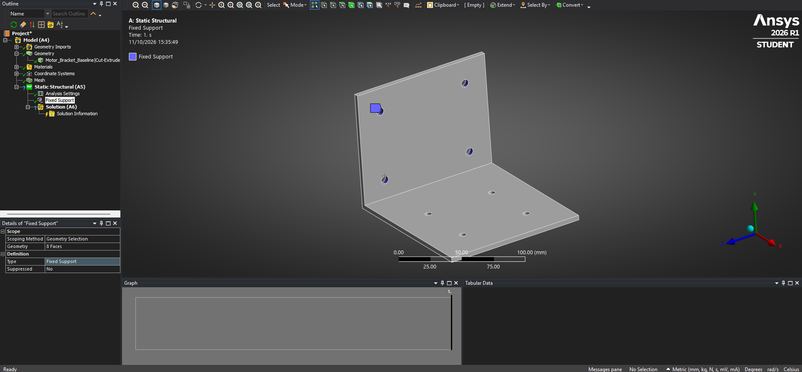 | 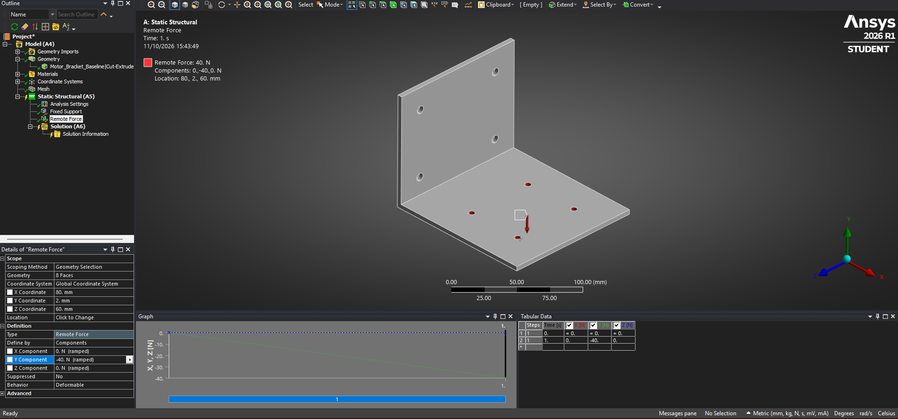 |

_The setup screenshots show the original R0 study; the four-hole support and load scoping were subsequently checked again for the parameterised R10 model._

<details>
<summary><strong>Original R0 baseline - FEA contours</strong></summary>

The following screenshots illustrate the **original R0 baseline**, not the optimised R10 geometry. The final R10 results are presented in Section 5.

|                                       Total deformation, R0                                        |                                     Equivalent stress, R0                                      |
| :------------------------------------------------------------------------------------------------: | :--------------------------------------------------------------------------------------------: |
| 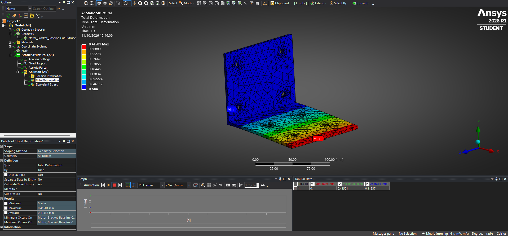 | 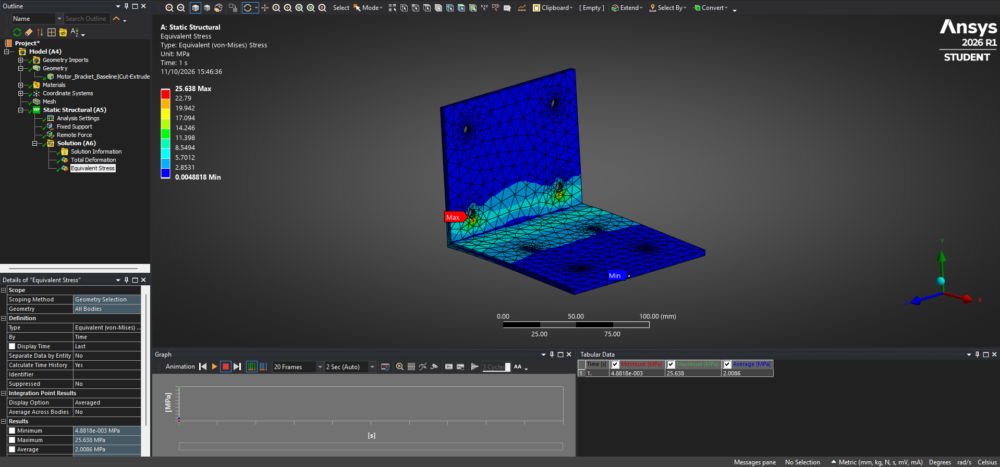 |

</details>

---

## 3. Result animations

These are **R0 baseline animations**, useful for visualising how a supported L-bracket bends and where stress concentrates. The visual deformation scale is exaggerated for display; use the numerical result tables for physical magnitudes.

|                                         Deformation animation                                          |                                         von Mises stress animation                                         |
| :----------------------------------------------------------------------------------------------------: | :--------------------------------------------------------------------------------------------------------: |
|  |  |

[Full deformation animation (WMV)](Animations/36_R0_Deformation_Animation.wmv) · [Full stress animation (WMV)](Animations/37_R0_Stress_Animation.wmv)

---

## 4. Parametric thickness sweep

After selecting the R10 configuration, I parameterised the plate thickness in DesignModeler and ran **15 ANSYS design points (14 unique thicknesses)** from 2 to 6 mm. ANSYS recorded **maximum deformation, maximum von Mises stress and mass** at each point.

### Thickness vs deformation

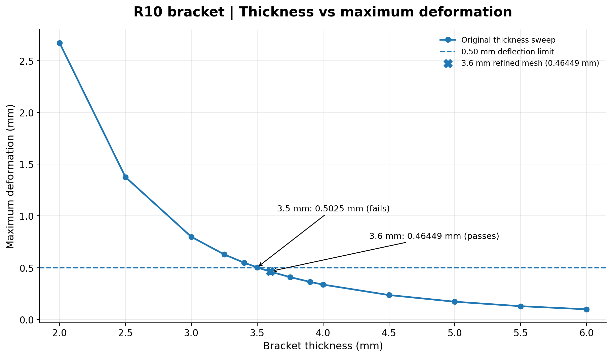

- **3.5 mm:** 0.50250 mm - narrowly **fails** the project's displacement criterion.
- **3.6 mm:** 0.46143 mm - **passes** the preliminary sweep.
- **3.75 mm:** 0.40858 mm - greater margin, with more mass.

### Thickness vs mass

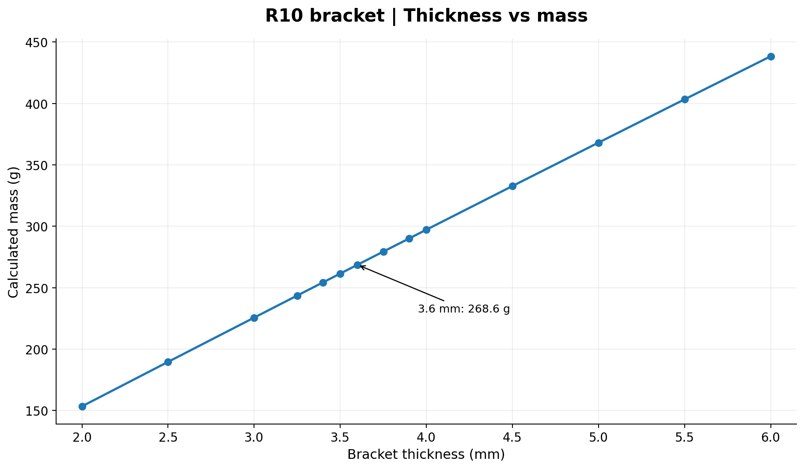

Relative to the **4 mm R10 reference (297.15 g)**, the **3.6 mm version (268.60 g)** saves **28.55 g**, or approximately **9.61%**.

<details>
<summary><strong>More trade-off figures - peak stress and mass vs deformation</strong></summary>

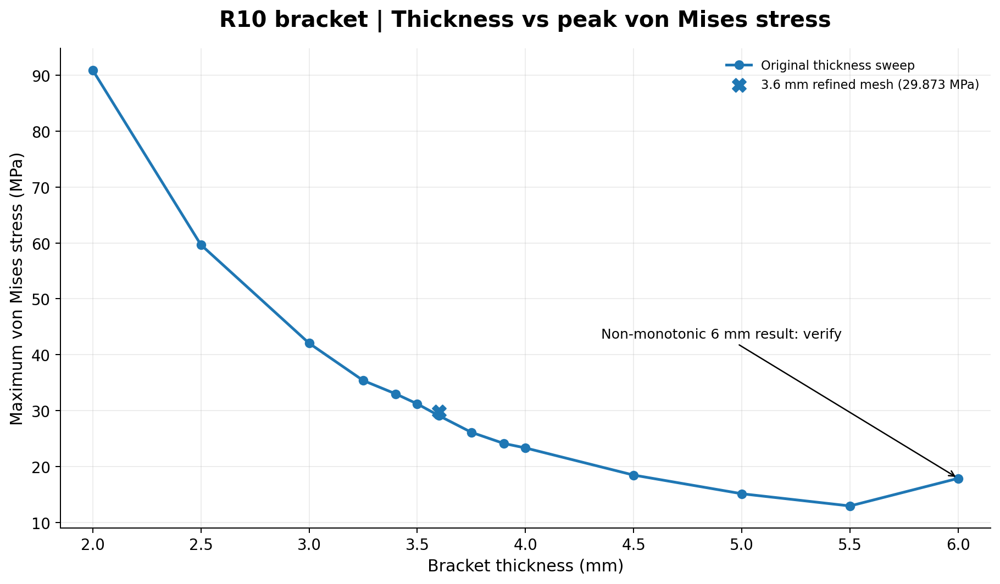

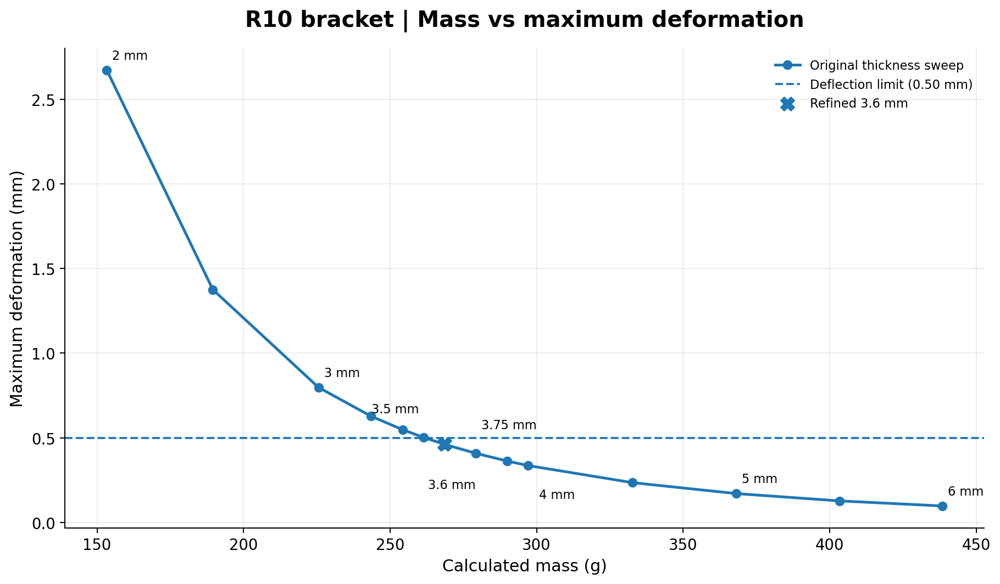

**Note:** The 6 mm result has a higher reported peak stress than the 5.5 mm result. This anomaly requires further investigation and is not interpreted as an established physical trend.

</details>

<details>
<summary><strong>Full thickness sweep - 14 unique thicknesses</strong></summary>

| Thickness (mm) |   Mass (g) | Max deformation (mm) | Peak von Mises (MPa) | 0.5 mm criterion |
| -------------: | ---------: | -------------------: | -------------------: | :--------------: |
|           2.00 |     153.35 |              2.67140 |               90.907 |       Fail       |
|           2.50 |     189.54 |              1.37520 |               59.670 |       Fail       |
|           3.00 |     225.58 |              0.79779 |               42.066 |       Fail       |
|           3.25 |     243.53 |              0.62771 |               35.396 |       Fail       |
|           3.40 |     254.28 |              0.54829 |               33.012 |       Fail       |
|           3.50 |     261.45 |              0.50250 |               31.216 |       Fail       |
|       **3.60** | **268.60** |          **0.46143** |           **29.106** |     **Pass**     |
|           3.75 |     279.32 |              0.40858 |               26.132 |       Pass       |
|           3.90 |     290.02 |              0.36293 |               24.138 |       Pass       |
|           4.00 |     297.15 |              0.33623 |               23.337 |       Pass       |
|           4.50 |     332.70 |              0.23561 |               18.481 |       Pass       |
|           5.00 |     368.08 |              0.17107 |               15.144 |       Pass       |
|           5.50 |     403.31 |              0.12788 |               12.962 |       Pass       |
|           6.00 |     438.37 |              0.09796 |               17.898 |       Pass       |

_The 15th point is a repeated 4 mm reference case. It is preserved in the original dataset but plotted once._

</details>

**Dataset:** [Thickness_Sweep_Results.csv](Results/Thickness_Sweep_Results.csv)

---

## 5. Mesh verification

The 3.6 mm candidate has limited deflection margin, so I repeated the analysis with progressively finer mesh controls. A full global 2 mm mesh exceeded the ANSYS Student numerical size limit; instead, I refined the **R10 inner fillet locally to 2 mm**, retaining a 3 mm global mesh.

| Mesh                            |        Nodes |     Elements | Maximum deformation | Maximum von Mises |
| :------------------------------ | -----------: | -----------: | ------------------: | ----------------: |
| Global 4 mm                     | Not recorded | Not recorded |          0.46143 mm |        29.106 MPa |
| Global 3 mm                     |       62,435 |       36,306 |          0.46391 mm |        30.226 MPa |
| Global 3 mm + local 2 mm fillet |   **69,652** |   **41,018** |      **0.46449 mm** |    **29.873 MPa** |

**Change from 3 mm global to locally refined mesh:**

- Maximum deformation: **+0.13%**.
- Reported peak stress: **-1.17%**.

This provides encouraging **displacement convergence for the tested refinements**. It does not establish convergence of every local peak stress, especially near the fully fixed mounting-hole surfaces.

### Refined R10 results (3.6 mm thickness)

The refined **deformation contour** is shown at the top of this README (**0.46449 mm maximum**). The corresponding stress result is shown below.

<p align="center"><a href="Results/FEA/02_R10_3p6mm_Stress.png">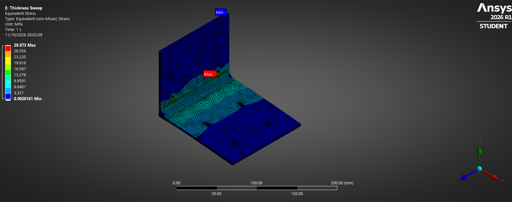</a></p>
<p align="center"><em>Equivalent (von Mises) stress: 29.873 MPa maximum for the specified static model.</em></p>

**Mesh dataset:** [Mesh_Verification_3p6mm.csv](Results/Mesh_Verification_3p6mm.csv)

---

## 6. Design decision

| Candidate      |         Mass |      Maximum deformation | Assessment                                             |
| :------------- | -----------: | -----------------------: | :----------------------------------------------------- |
| **3.6 mm R10** | **268.60 g** | **0.46449 mm** (refined) | Lightest passing **tested** configuration              |
| 3.75 mm R10    |     279.32 g |  0.40858 mm (sweep mesh) | More displacement margin; not separately mesh-verified |
| 4.0 mm R10     |     297.15 g |  0.33623 mm (sweep mesh) | Heavier, potentially easier to source                  |

**Selected numerical candidate: 3.6 mm R10.** It meets the assumed 0.5 mm deflection criterion after local mesh refinement, with an approximately 9.6% mass reduction versus the 4 mm R10 reference.

Its refined displacement margin is **0.03551 mm (7.1% of the target)**. Using 275 MPa nominal tensile yield strength divided by the 29.873 MPa reported peak stress gives an **indicative material yield-stress ratio of 9.2**, not a validated assembly-level factor of safety.

**Practical decision:** 3.75 mm offers additional numerical deflection margin; 4 mm may be preferable where readily available stock, manufacturability or uncertainty in the boundary conditions matters more than saving approximately 29 g.

### Limitations and further work

- **Bolted joints:** Fixed cylindrical mounting-hole faces idealise real bolts, preload, contact and support flexibility.
- **Loading:** The simulation covers a single 40 N static load, not motor torque, vibration or fatigue.
- **Stress:** Peak stresses near constraints remain sensitive to local mesh and constraint representation.
- **Geometry:** The larger-thickness sweep points and the 6 mm stress increase warrant geometry/mesh investigation.
- **Manufacturing:** The R10 radius and chosen plate thickness require a feasible manufacturing route and stock availability check.
- **Validation:** Physical prototyping and displacement measurement are required before claiming in-service performance.

---

## Repository files

```text
lightweight-motor-bracket-fea/
├── CAD/                         SolidWorks and DesignModeler files
├── FEA/                         ANSYS structural study artifacts
├── docs/                        Numbered CAD and analysis screenshots
├── Animations/                  R0 baseline deformation/stress GIF and WMV
├── Results/
│   ├── FEA/                     Cropped refined 3.6 mm ANSYS contour images
│   ├── Graphs/                  Four parametric design trade-off charts
│   ├── Thickness_Sweep_Results.csv
│   ├── Mesh_Verification_3p6mm.csv
├── .gitignore
└── README.md
```

Some ANSYS working files contain solver-generated data and may depend on ANSYS version. The screenshots, animations, charts and CSV outputs are intended to make the study accessible without opening the solver.

---

## Author

**Farhan Ali**  
Mechanical Engineering Student | CAD, FEA & Structural Optimisation

- **GitHub:** [farhan10904](https://github.com/farhan10904)
- **Portfolio:** [Farhan Ali Engineering Portfolio](https://farhan10904.github.io/engineering-portfolio/)
- **LinkedIn:** [Farhan Ali](https://www.linkedin.com/in/farhan-ali-95047a245/)

Built as an independent engineering project exploring mechanical design, finite element analysis, mesh verification, parametric optimisation and lightweight structural design.

---

## Acknowledgements

**Software:** SolidWorks and ANSYS Mechanical were used for CAD development, structural simulation and parametric analysis.

**AI assistance:** AI tools were used for project planning, technical explanations, troubleshooting and documentation assistance. CAD development, simulation setup, engineering decisions, result interpretation and verification were carried out and reviewed by the author.

---
